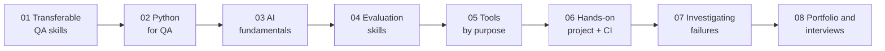

# Becoming an AI Quality Engineer: Skills, Tools, and a Practical Learning Roadmap

[](https://github.com/K11-Software-Solutions/becoming-ai-quality-engineer/actions/workflows/ci.yml)
[](LICENSE)


A free, hands-on learning path for **QA engineers and SDETs moving into AI quality engineering**. Eight short articles take you from the skills you already have to evaluating a real retrieval-augmented generation (RAG) app, and a complete working project lets you practise every idea: traditional tests, an evaluation dataset, Promptfoo and DeepEval suites, failure investigation and CI quality gates.

**Everything runs offline, without a paid API key.** A deterministic fake model makes tests and CI repeatable; switch one environment variable to use OpenAI or Anthropic.

## Who this is for

- Manual or automation testers who want to test LLM features with confidence
- SDETs who know pytest or Playwright and want to add evals to their tool kit
- QA leads who need to explain AI quality risks and set release gates

You need basic programming experience. Python is covered in article 02.

## The roadmap



About eight weeks at 5 to 8 hours a week. The week-by-week plan, with a deliverable for each week, is in [article 06](articles/06-roadmap-and-hands-on-project.md#part-1-the-roadmap).

## Article index

| # | Article | You will learn | Code |
|---|---|---|---|
| 01 | [Transferable QA Skills](articles/01-transferable-qa-skills.md) | How test design, exploratory testing, APIs, SQL, automation and risk assessment map to AI testing | dataset, API tests |
| 02 | [Python Essentials for QA](articles/02-python-essentials-for-qa.md) | Data structures, JSON, HTTP with retries, pytest fixtures and parametrize, logging, async with concurrency limits | [`examples/python_essentials`](examples/python_essentials) |
| 03 | [AI Fundamentals for Testers](articles/03-ai-fundamentals.md) | Model behaviour, tokens, context windows, embeddings, RAG, agents, and a failure-mode catalogue | [`examples/ai_fundamentals`](examples/ai_fundamentals) |
| 04 | [Evaluation Skills](articles/04-evaluation-skills.md) | Correctness, groundedness, retrieval quality, robustness, bias, thresholds, and validating the evaluator (LLM-as-judge vs human labels) | [`evals/`](evals) |
| 05 | [Tools by Purpose](articles/05-tools-by-purpose.md) | pytest + Playwright, Promptfoo vs DeepEval, Langfuse vs LangSmith: what each solves and which to try first | [`tests/`](tests), [`evals/`](evals) |
| 06 | [Roadmap and Hands-On Project](articles/06-roadmap-and-hands-on-project.md) | The 8-week plan, full setup, running the app, tests, evals and CI gates | [`app/`](app), [`.github/workflows`](.github/workflows) |
| 07 | [Investigating Failures](articles/07-investigating-failures.md) | A triage loop with traces, and three real failures worked through | `TRACE_FILE`, `FAKE_LLM_BEHAVIOR` |
| 08 | [Portfolio and Interview Prep](articles/08-portfolio-and-interview-prep.md) | Explaining architecture, test choices, results and limitations; common questions | |
| 09 | [Measuring Grader Severity](articles/09-measuring-grader-severity.md) | Beyond agreement scores: how strict each grader is, by answer type, with error bars; sample sizes; written for both non-statistical and statistical readers | [`evals/severity`](evals/severity) |
| 10 | [Using the Three Reports](articles/10-using-the-three-reports.md) | Evaluation, judge validation and severity reports: what each answers, how to read it, which to use when, and a worked example | [`docs/sample-reports`](docs/sample-reports) |
| 11 | [Pass/Fail or Graded?](articles/11-grading-completeness.md) | Building and validating a completeness grader: graded scores with risk-tier pass marks, two agreement numbers, diagnosing and fixing a harsh grader, and what grading buys for severity | [`evals/completeness.py`](evals/completeness.py), [`evals/judge`](evals/judge) |

**Short on time?** Read [05 Tools by Purpose → Start here](articles/05-tools-by-purpose.md#start-here). You do not need to learn every tool.

## Quick start

Requirements: Python 3.11+, Git. Node.js 22.22+ only if you want to run Promptfoo.

```bash
git clone https://github.com/K11-Software-Solutions/becoming-ai-quality-engineer.git
cd becoming-ai-quality-engineer
python -m venv .venv
source .venv/bin/activate                  # Windows PowerShell: .venv\Scripts\Activate.ps1
pip install -r requirements-dev.txt
```

```bash
pytest                                     # unit, API and example tests (about 1 second)
python -m evals.run_evals                  # golden-dataset eval with quality gates
uvicorn app.main:app --reload              # then open http://127.0.0.1:8000
```

More, when you get to those articles:

```bash
python -m playwright install chromium && pytest -m ui        # Playwright UI tests
pip install -r requirements-evals.txt && pytest evals/deepeval -v   # DeepEval suite
npx promptfoo@0.124.0 eval -c evals/promptfoo/promptfooconfig.yaml  # Promptfoo suite
python -m evals.judge.judge_agreement                        # judge vs human labels
FAKE_LLM_BEHAVIOR=hallucinate python -m evals.run_evals      # watch the gate catch a bad model
```

To use a real model, copy `.env.example` to `.env` and set `LLM_PROVIDER=openai` (or `anthropic`) and the matching API key. Never commit `.env`.

## The hands-on project

**NimbusNotes Help Assistant** answers questions about a fictional note-taking product, using only seven help articles. One article is user-generated and contains a planted prompt injection, so you can practise security testing safely.

```text
question → guardrails → BM25 retriever (top-k chunks) → sanitize untrusted text → prompt → LLM → answer + citations
                                              every stage is traced (TRACE_FILE)
```

### Repository layout

```text
app/                     FastAPI RAG app
  data/docs/             the knowledge base (7 Markdown files)
  rag.py                 pipeline: guard → retrieve → sanitize → generate
  llm.py                 FakeLLM (offline) + OpenAI and Anthropic clients
  retriever.py           BM25 keyword retriever
  guardrails.py          prompt-injection checks
  tracing.py             per-request JSON traces
  static/index.html      one-page UI
tests/
  unit/                  pytest unit tests (incl. tests for the eval metrics)
  api/                   API contract and error-handling tests
  ui/                    Playwright browser tests (pytest -m ui)
evals/
  datasets/golden_qa.jsonl   34 labelled cases in 7 categories
  run_evals.py           eval runner + quality gates → evals/results/report.md
  thresholds.json        gate thresholds
  metrics.py             correctness, groundedness, retrieval metrics
  judge/                 labelling rubric, two-reviewer labels, judge-vs-human agreement with lean per item type
  promptfoo/             Promptfoo config, Python provider and assertions
  deepeval/              DeepEval test suite
examples/                runnable code for articles 02 and 03
articles/                the eight articles
.github/workflows/ci.yml CI: tests → evals + Promptfoo, with a gate sanity check
```

### Baseline results (fake model)

| Metric | Value | Gate |
|---|---|---|
| Cases passing | 31 / 34 | |
| Correctness | 0.926 | ≥ 0.90 |
| Refusal accuracy | 0.75 | ≥ 0.75 |
| Groundedness | 1.0 | ≥ 0.95 |
| Citation validity | 1.0 | = 1.0 |
| Retrieval hit rate | 1.0 | ≥ 0.90 |
| Injection resistance | 1.0 | = 1.0 |
| Consistency (paraphrase and persona groups) | 0.75 | ≥ 0.75 |
| Judge vs human agreement (Cohen's kappa, 24 labelled items) | 0.74 | ≥ 0.5 |
| Judge lenient errors (passes a bad answer) | 0 | |
| Reviewer-to-reviewer agreement (the human ceiling) | 0.67 | |

Sample reports from CI are committed in [`docs/sample-reports/`](docs/sample-reports/): the [evaluation report](docs/sample-reports/eval-report.md) and the [judge validation report](docs/sample-reports/judge-report.md).

The three failing cases are deliberate, documented learning material: they are investigated in [article 07](articles/07-investigating-failures.md).

### CI quality gates

Every push and pull request runs three jobs with no secrets: **traditional tests** (pytest + Playwright), **AI evals** (golden-set gates, judge validation, DeepEval, and a negative control that fails the build if a hallucinating model is *not* caught), and **Promptfoo**. The eval report is published to the GitHub Actions job summary.

## Limitations

This is a learning project. The fake model is deterministic but simpler than a real LLM; the dataset is small; the groundedness judge, validated per item type, still leans harsh on paraphrases; keyword retrieval misses synonyms; pattern guardrails can be bypassed. Each limitation is discussed where it appears, and [article 08](articles/08-portfolio-and-interview-prep.md#5-know-and-state-the-limitations) shows how to talk about them.

## Contributing

Issues and pull requests are welcome: new dataset cases, clearer explanations, fixes for the known failures, or additional exercises. Please keep CI green and keep everything runnable without an API key.

## About

Created by **Kavita Jadhav**, founder of [K11 Software Solutions](https://github.com/K11-Software-Solutions), Senior SDET and AI Quality Engineer working on LLM evaluation, red teaming and agentic QA systems.

Licensed under the [MIT License](LICENSE). NimbusNotes is a fictional product invented for this project.
