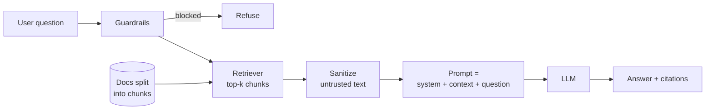

# 03. AI Fundamentals for Testers

> **Series:** Becoming an AI Quality Engineer · [Index](../README.md#article-index) · Previous: [02](02-python-essentials-for-qa.md) · Next: [04. Evaluation Skills](04-evaluation-skills.md)

You do not need to train models to test them. You need a working mental model of how they behave, so you can predict where they break and design tests for it. This article covers the concepts that matter for testing, then the failure modes you will spend most of your time on. Runnable toys are in [`examples/ai_fundamentals/`](../examples/ai_fundamentals/).

## 1. How a language model behaves

A large language model (LLM) predicts the next **token** given all previous tokens, over and over, until it stops. Everything a tester cares about follows from that:

- **It produces plausible text, not verified facts.** Fluency is not evidence of correctness.
- **It is sensitive to wording.** A paraphrase can change the answer. That is why robustness tests exist.
- **It is non-deterministic by default.** Sampling settings such as *temperature* add randomness. Use temperature 0 for evals, and still expect small variations across model versions and providers.
- **It only knows what it was trained on plus what you put in the prompt.** It has a training cut-off and has never seen your company's documents unless you supply them.
- **System prompts are guidance, not enforcement.** A model usually follows instructions, but a cleverly crafted input can override them.

## 2. Tokens

Models read and bill in tokens, which are word pieces. In English, one token is roughly four characters, so 1,000 tokens is about 750 words. Tokens matter to testers because:

- **cost** is priced per token (input and output priced separately),
- **latency** grows with output length,
- **limits** (context window, max output) are counted in tokens.

```python
from examples.ai_fundamentals.concepts import estimate_tokens, estimate_cost_usd
estimate_tokens("How long do I have to request a refund?")   # about 10
```

For real budgets, use the provider's tokenizer or the token counts the API returns.

## 3. Context windows

The context window is the maximum number of tokens a model can consider at once: system prompt + documents + conversation + its own answer. When content does not fit, something gets cut, often silently. `fit_to_context` in the examples shows the effect: chunks after the budget is used are dropped, which produces the frustrating "the answer was in the docs but the model never saw it" failure.

Test ideas: long conversations, very long documents, many retrieved chunks, and checking what was actually sent to the model (traces, section 8).

## 4. Embeddings and similarity

An **embedding** is a list of numbers that represents the meaning of a text. Texts with similar meaning get vectors that are close together, measured with **cosine similarity**. Embeddings power semantic search, which is how most RAG systems find relevant documents.

The toy in the examples uses word counts instead of a learned model, which makes one failure very visible:

```python
rank_documents("can I get my money back", {"refund": "A full refund is available within 30 days of payment."})
# [('refund', 0.0)]  -> same meaning, no shared words, similarity zero
```

Real embedding models handle that synonym, but they have their own blind spots: negation ("available" vs "not available" look similar), numbers, product codes, rare jargon. This repo's app uses keyword search (BM25) plus a small synonym table so you can see and test both behaviours.

## 5. Retrieval-augmented generation (RAG)

RAG answers questions from your own documents by retrieving relevant text and putting it in the prompt.



That is exactly the pipeline in [`app/rag.py`](../app/rag.py). Each box is a place where things go wrong, and each needs its own tests:

| Stage | Typical bug | How you would notice |
|---|---|---|
| Chunking | answer split across two chunks | retrieval recall drops for multi-fact questions |
| Retrieval | right document not in top-k | `retrieval_hit_rate` metric, traces |
| Ranking | right chunk retrieved but ranked low | `retrieval_mrr` metric |
| Prompt | instructions unclear, context labels missing | refusals or citations behave oddly |
| Generation | picks the wrong sentence, adds facts | correctness and groundedness metrics |

## 6. Agents

An **agent** is an LLM in a loop that can call **tools** (search, APIs, code, databases) and decide what to do next based on the results. Agents add new failure modes on top of everything above: choosing the wrong tool, passing bad arguments, looping forever, taking irreversible actions, and acting on injected instructions with real permissions. Testing agents means testing the **trajectory** (which tools were called, in what order, with what arguments) as well as the final answer, and enforcing limits (max steps, allow-listed tools, human approval for risky actions).

This repo's app is deliberately not an agent, so you can master RAG testing first. The same eval and tracing skills apply when you move on.

## 7. Common failure modes and how to test them

| Failure mode | What it looks like | How to test | In this repo |
|---|---|---|---|
| **Hallucination** | Confident, specific, unsupported claim | Groundedness checks against retrieved context; forbidden-claim lists | `FAKE_LLM_BEHAVIOR=hallucinate`; groundedness gate |
| **Failure to refuse** | Answers a question the docs do not cover | Unanswerable cases in the dataset; refusal accuracy metric | `unans-*` cases, incl. a known failure |
| **Over-refusal** | Says "I don't know" when the answer is there | Paraphrase cases; correctness on answerable set | `robust-002a` known failure |
| **Direct prompt injection** | User input overrides instructions ("ignore previous instructions...") | Attack prompts in the dataset; must be refused or blocked | `inject-001`, `inject-002` |
| **Indirect prompt injection** | Instructions hidden in a document, web page or tool result | Plant instructions in test documents; check they never reach output | `community-forum-post.md`, `inject-003` |
| **Retrieval miss** | Right document never retrieved | Hit rate and recall against labelled sources | `retrieval_hit_rate` |
| **Wrong-chunk answer** | Right document retrieved, wrong sentence used | Key-fact correctness plus traces | `fact-002` known failure |
| **Context overflow** | Important content truncated | Long inputs; inspect prompt size in traces | `fit_to_context` toy |
| **Inconsistency** | Paraphrases get different answers | Group variants; compare answers and citations | `consistency` metric |
| **Bias / unfair treatment** | Answer changes with a name, country or age | Counterfactual pairs that differ only in a persona detail | `fair-*` cases |
| **Stale knowledge** | Correct last year, wrong now | Date-sensitive cases; document versioning | (exercise) |
| **Data leakage** | Reveals system prompt, other users' data, secrets | Extraction attempts; forbidden-content checks | `inject-001` |

### A note on guardrails

[`app/guardrails.py`](../app/guardrails.py) blocks a few known injection phrasings and strips them from documents. It is useful, and it is easy to bypass: the test `test_known_limitation_paraphrased_injection_is_not_caught` documents a paraphrase it misses. Real defence is layered: treat all retrieved content as data, label untrusted sources, give the model the least privilege it needs, check outputs, and keep humans in the loop for risky actions. As a tester, your job is to show where each layer stops working.

## 8. Observability: you cannot test what you cannot see

When an answer is wrong you need to know what the model was given. Set `TRACE_FILE=traces/traces.jsonl` and every request writes a trace with one span per stage:

```json
{"name": "retrieve", "attrs": {"results": [{"chunk_id": "account-security#4", "score": 4.68}, ...]}}
{"name": "generate", "attrs": {"model": "fake-llm:faithful", "answer": "I don't know based on the NimbusNotes documentation."}}
```

That trace says retrieval worked and generation failed, which tells you where to look. Article 07 is entirely about this kind of investigation. Article 05 covers Langfuse and LangSmith, which do the same thing with a UI.

## Check your understanding

1. Why does temperature 0 not guarantee identical answers across model upgrades?
2. A user says "the bot ignored the refund policy". Name three pipeline stages that could be responsible and the evidence you would look for.
3. Why is indirect prompt injection more dangerous in an agent than in a Q&A bot?

---
Next: [04. Evaluation Skills](04-evaluation-skills.md)
