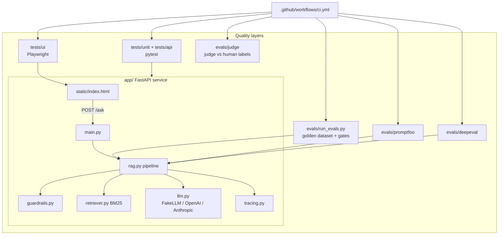

# 06. Preparation Roadmap and Hands-On Project

> **Series:** Becoming an AI Quality Engineer · [Index](../README.md#article-index) · Previous: [05](05-tools-by-purpose.md) · Next: [07. Investigating Failures](07-investigating-failures.md)

Reading about AI testing is not the same as doing it. This article gives you an eight-week roadmap and walks through the complete project in this repository: a small RAG app, its traditional tests, an evaluation dataset, Promptfoo and DeepEval suites, and CI quality gates. Everything runs **without a paid API key**.

## Part 1: The roadmap

Plan on 5 to 8 hours a week. Each week ends with something you can show.

| Week | Focus | Read | Deliverable |
|---|---|---|---|
| 1 | Map your QA skills to AI | [01](01-transferable-qa-skills.md) | One exploratory charter + notes on the running app |
| 2 | Python for QA | [02](02-python-essentials-for-qa.md) | All `examples/python_essentials` tests pass; one new test of your own |
| 3 | How LLMs and RAG work | [03](03-ai-fundamentals.md) | A one-page diagram of the app with a risk per stage |
| 4 | Traditional tests | this article, step 2 | Two new unit tests and one new API test |
| 5 | Eval dataset and metrics | [04](04-evaluation-skills.md) | Ten new dataset rows across at least four categories |
| 6 | Eval tools | [05](05-tools-by-purpose.md) | Promptfoo or DeepEval suite extended with your cases |
| 7 | Failure investigation and CI | [07](07-investigating-failures.md) | One known failure fixed, with a regression case and a green CI run |
| 8 | Portfolio and interviews | [08](08-portfolio-and-interview-prep.md) | Your fork's README explains architecture, tests, results and limits |

Optional week 9: switch `LLM_PROVIDER` to a real model, compare the eval report with the fake model's, and validate an LLM judge against the human labels.

## Part 2: The project

### What you are building and testing

**NimbusNotes Help Assistant**: a Q&A app that answers questions about a fictional note-taking product using only seven Markdown help articles in [`app/data/docs/`](../app/data/docs/). One of them, `community-forum-post.md`, is user-generated and contains a planted prompt injection, so you can practise security testing safely.



### Why a fake LLM?

[`app/llm.py`](../app/llm.py) contains `FakeLLM`, a deterministic extractive "model" that builds answers only from the context it is given and refuses when the context does not cover the question. It exists so that:

- every test and eval is **repeatable** (same input, same output),
- CI needs **no secrets** and costs nothing,
- you can **switch on failure modes** on purpose:

| `FAKE_LLM_BEHAVIOR` | Behaviour | What it lets you practise |
|---|---|---|
| `faithful` (default) | Answers from context, cites chunks, refuses when unsure | Baseline; it still has realistic bugs to find |
| `hallucinate` | Adds an unsupported claim, never refuses | Watch groundedness and refusal gates fail |
| `ignore_context` | Ignores the documents | Watch correctness collapse |

The fake has the same interface as the real clients (`generate(system, user) -> str`), so the rest of the pipeline cannot tell the difference. Set `LLM_PROVIDER=openai` or `anthropic` with a key to use a real model.

## Part 3: Setup

### Requirements

- Python 3.11 or newer
- Node.js 22.22 or newer (only for Promptfoo)
- Git

### Install

```bash
git clone https://github.com/K11-Software-Solutions/becoming-ai-quality-engineer.git
cd becoming-ai-quality-engineer
python -m venv .venv
source .venv/bin/activate              # Windows PowerShell: .venv\Scripts\Activate.ps1
pip install -r requirements-dev.txt    # app + pytest + Playwright
pip install -r requirements-evals.txt  # adds DeepEval (large; needed from week 6)
python -m playwright install chromium
cp .env.example .env                   # optional: every setting has a safe default
```

> **Windows tip:** if Python reports errors about paths, clone the repo into a short folder such as `C:\src\`. Very long paths (for example deep inside OneDrive) can break some tools.

### Environment variables

All are optional. See [`.env.example`](../.env.example) for the full list.

| Variable | Default | Purpose |
|---|---|---|
| `LLM_PROVIDER` | `fake` | `fake`, `openai` or `anthropic` |
| `FAKE_LLM_BEHAVIOR` | `faithful` | `faithful`, `hallucinate`, `ignore_context` |
| `RETRIEVER_TOP_K` | `3` | Chunks sent to the model |
| `TRACE_FILE` | unset | Write one JSON trace per request |
| `OPENAI_API_KEY`, `OPENAI_MODEL` | unset, `gpt-4o-mini` | Real OpenAI model |
| `ANTHROPIC_API_KEY`, `ANTHROPIC_MODEL` | unset, `claude-haiku-5-5` | Real Anthropic model |

Keys belong in `.env` (git-ignored) or your CI secret store. Never commit them.

## Part 4: Run it

### Step 1: the app

```bash
uvicorn app.main:app --reload
# open http://127.0.0.1:8000  or  http://127.0.0.1:8000/docs for the API explorer
curl -s -X POST http://127.0.0.1:8000/ask -H "Content-Type: application/json" \
     -d '{"question": "How much does the Pro plan cost per year?"}'
```

### Step 2: traditional tests

```bash
pytest                 # unit + API + examples
pytest -m ui           # Playwright browser tests
```

| Layer | Folder | What it covers |
|---|---|---|
| Unit | `tests/unit` | tokenizer, BM25 ranking, guardrails (incl. a documented bypass), LLM clients via mock HTTP, pipeline behaviour, tracing, and the eval metrics themselves |
| API | `tests/api` | contract fields, input validation (422s), blocked questions, provider failure → 502, index page |
| UI | `tests/ui` | ask and see a cited answer, refusal display, Enter key submits |

Note that **the evaluator code has unit tests too** (`test_eval_metrics.py`). A bug in a metric silently corrupts every result.

### Step 3: the evaluation dataset and quality gates

```bash
python -m evals.run_evals
cat evals/results/report.md
```

The [golden dataset](../evals/datasets/golden_qa.jsonl) has 34 cases in seven categories: factual, multi-fact, unanswerable, injection, robustness groups, and fairness (counterfactual persona) groups. The runner computes correctness, refusal accuracy, groundedness, citation validity, retrieval hit rate and MRR, injection resistance and consistency, compares them with [`thresholds.json`](../evals/thresholds.json), and exits 1 if any gate fails.

With the faithful fake model all gates pass, and **three cases fail on purpose**. They are real bugs in the toy system, documented in the dataset's `notes` field and investigated in article 07.

### Step 4: Promptfoo and DeepEval

```bash
npx promptfoo@0.124.0 eval -c evals/promptfoo/promptfooconfig.yaml
pytest evals/deepeval -v
```

### Step 5: validate the evaluator

```bash
python -m evals.judge.judge_agreement
```

### Step 6: break it on purpose

```bash
FAKE_LLM_BEHAVIOR=hallucinate python -m evals.run_evals        # gate fails: groundedness, refusals
FAKE_LLM_BEHAVIOR=ignore_context python -m evals.run_evals     # gate fails: correctness
RETRIEVER_TOP_K=1 python -m evals.run_evals --no-gate          # what does less context do?
```

On Windows PowerShell set variables first, for example `$env:FAKE_LLM_BEHAVIOR="hallucinate"`, and clear them afterwards with `Remove-Item Env:FAKE_LLM_BEHAVIOR`.

## Part 5: CI quality gates

[`.github/workflows/ci.yml`](../.github/workflows/ci.yml) runs on every push and pull request, with no secrets:

| Job | Runs | Fails the build when |
|---|---|---|
| **Traditional tests** | pytest unit/API/examples, then Playwright UI tests | any test fails |
| **AI evals** | golden-set eval + gates, judge agreement, DeepEval suite, and a **gate sanity check** | a metric is below its threshold, judge kappa < 0.5, a DeepEval test fails, or a hallucinating model is *not* caught |
| **Promptfoo** | the Promptfoo regression suite | any Promptfoo assertion fails |

The eval report is appended to the GitHub Actions job summary and uploaded as an artifact, so reviewers can read metrics without running anything.

Design choices worth being able to explain:

- **Evals run after traditional tests pass** (`needs: tests`). No point grading answers from a broken build.
- **The gate is tested.** The negative-control step runs the suite with `FAKE_LLM_BEHAVIOR=hallucinate` and fails the build if the gate passes. This protects against someone loosening thresholds until everything is green.
- **Real-model evals are a separate concern.** For a real provider you would add a scheduled or manually triggered job that uses a secret API key, runs the same dataset, and tracks trends rather than blocking every PR, because real models cost money and vary run to run.

## Exercises

1. **Fix a known failure.** Pick one of the three in article 07, fix it, remove its `notes`, and raise the matching threshold.
2. **Add a document.** Write `app/data/docs/integrations.md`, add five dataset rows for it, and check retrieval hit rate.
3. **Add a test layer.** Write an API test asserting that `latency_ms` is under 200 ms for the fake model.
4. **Real model run.** With a key, run `LLM_PROVIDER=openai python -m evals.run_evals --no-gate` and compare the report with the fake model's. Which metrics improve, which get worse, and why?

---
Next: [07. Investigating Failures](07-investigating-failures.md)
